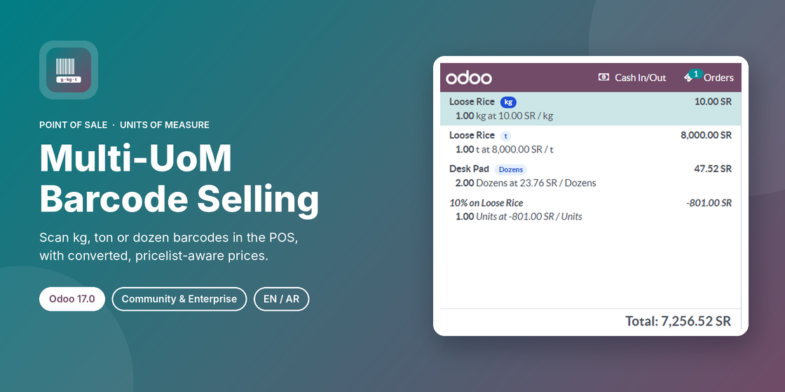

# POS Multi-UoM Barcode Selling (Odoo 17.0)



Odoo Point of Sale app to sell the same product by the gram, the kilo or the ton, or by the unit
and the dozen, straight from the cashier's scanner. Each secondary unit of measure gets its own
barcode and its converted, pricelist-aware price; the unit then follows the sale to the receipt,
the backend order, the invoice and the stock moves.

**Branches:** [16.0](../../tree/16.0) · **17.0** · [18.0](../../tree/18.0) · [19.0](../../tree/19.0) · [20.0](../../tree/20.0). Each branch holds the module ported to that Odoo version.

| | |
|---|---|
| Odoo version | 17.0, Community and Enterprise |
| Technical name | `pos_multi_uom_barcode_selling` |
| Depends on | `point_of_sale`, `pos_loyalty` |
| Settings | Point of Sale › Configuration › Settings › **Multi-UoM Barcode Selling** (per POS, off by default) |
| Menu | Point of Sale › Products › UoM Barcodes, and a **UoM Barcodes** tab on POS products |
| Languages | English, Arabic |
| Automated tests | 24 |
| License | LGPL-3 |

## Features

- **UoM barcodes** per product: one barcode per secondary unit (KG, Ton, Dozen...); the main unit keeps the product barcode.
- **Uniqueness** in the database and the ORM against other UoM barcodes, product barcodes and packaging barcodes.
- **Zero-RPC scanning:** UoM barcodes are loaded and indexed once when the POS session opens.
- **Scan** adds 1 of the scanned unit at the converted price; pricelist minimum quantities are compared in the main unit.
- **Change UoM** action on the selected order line; lines in different units never merge.
- **Loyalty / promotions:** quantity rules count in the main unit (1 KG satisfies "minimum 500 g"); amount rules use the real totals.
- **Traceability:** the sold unit is stored on POS order lines and used on receipts, invoices, refunds, margins and stock moves.

## Installation

1. Put the `pos_multi_uom_barcode_selling` folder in your addons path, or add this repository
   (branch `17.0`) as an addons path / Odoo.sh submodule.
2. Update the apps list and install **POS Multi-UoM Barcode Selling**.
3. Enable **Multi-UoM Barcode Selling** on the POS, add UoM barcodes on the products, then:
   In the POS, open the menu › **Reload Data** › **Full** on each device (the POS keeps its settings in the browser).

## Running the tests

```
odoo-bin -d <database> -i pos_multi_uom_barcode_selling --test-enable \
    --test-tags /pos_multi_uom_barcode_selling --stop-after-init
```

## Author and support

**Ibrahim Yahia** · [LinkedIn](https://www.linkedin.com/in/ibrahim-yahia) · ibrahim.yahiah@gmail.com

Licensed under LGPL-3.
